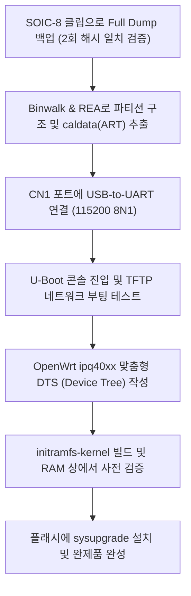
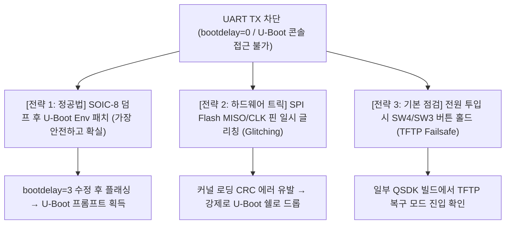

# KT GiGA WiFi Wave2 (올레디오 TI04-708H / WGHE0101) PCB 정밀 분석 보고서

이 보고서는 제공해주신 PCB 사진들을 바탕으로 공유기의 세부 하드웨어 부품 구성을 분석하고, **SOIC-8 클립을 이용한 펌웨어 덤프 주의사항**, **REA(Reverse Engineer Anything)를 통한 바이너리 분석**, 그리고 **OpenWrt 포팅 및 설치 로드맵**을 상세히 정리한 문서입니다.

---

## 1. 장치 식별 및 개요

| PCB 전면 (Top View) | PCB 후면 (Bottom View) |
| :---: | :---: |
|  |  |


- **제품 모델명**: **올레디오 (allRadio) TI04-708H** (KT GiGA WiFi Wave 2)
- **보드 모델 / 리비전**: `WGHE010100` / `WGHE0101` (`UASSY/3`)
- **제조사**: **(주)올레디오 (allRadio Co., Ltd.)** (보드 상단 대형 `allRadio` 로고 각인)
- **스티커 식별 정보**:
  - `GIGA WiFi WAVE2(중국생산) @WGHE0101`
  - `MSN: WGHE010102006903845`
  - `SOI: SO200301 WO200601 1` (2020년 생산분)
- **통신사 공급 배경**:
  - KT는 '기가 와이파이 웨이브2'를 3대 협력사(머큐리 `KM08-708H`, 올레디오 `TI04-708H`, 다보링크 `DV01-901H`)를 통해 공급받았습니다.
  - 본 보드는 그중 **올레디오의 독자 설계 보드(WGHE010100)**로, 퀄컴 IPQ4018 플랫폼을 기반으로 제작되었습니다.
- **PCB 제조**: ASKPCB (`94V-0`, `E239218`)

```mermaid
graph TD
    subgraph Core System
        SoC["Qualcomm Atheros IPQ4018<br/>(Quad-Core ARM Cortex-A7 @ 716.8MHz)"]
        RAM["Nanya DDR3L SDRAM<br/>256MB (NT5CC128M16JR-EK)"]
        Flash["SPI NAND / NOR Flash (SOIC-8 / U33)<br/>128MB Flash"]
        XTAL["48.000 MHz Crystal (Y1)"]
        SoC --- RAM
        SoC --- Flash
        SoC --- XTAL
    end

    subgraph RF Front-End (2.4G / 5G Wave2)
        FEM1["5GHz FEM: Skyworks SKY85405"]
        FEM2["5GHz FEM: Skyworks SKY85405"]
        FEM3["2.4GHz FEM: Skyworks FEM"]
        FEM4["2.4GHz FEM: Skyworks FEM"]
        SoC --- FEM1 & FEM2 & FEM3 & FEM4
    end

    subgraph Network & I/O
        ETH["Integrated Gigabit Switch<br/>(1x WAN + 4x LAN)"]
        MAG["LAN Transformers<br/>2x LG2P109N + 1x LG1P109N"]
        USB["USB 2.0 / 3.0 Port (CON1)"]
        UART["UART Console (CN1: 4-Pin Header)"]
        LEDS["LEDs (PWR, WAN, LAN1-4, WIFI)"]
        BTNS["Buttons (SW1 Reset, SW3 WPS, SW4 Fact)"]
        SoC --- ETH
        ETH --- MAG
        SoC --- USB
        SoC --- UART
        SoC --- LEDS & BTNS
    end
```

---

## 2. 주요 부품 정밀 분석

| Qualcomm IPQ4018 SoC | NANYA 256MB DDR3L RAM | RF Front-End (FEM) 블록 |
| :---: | :---: | :---: |
|  |  |  |


| 부품 구분 | 실장 위치 (Silk) | 파트 넘버 (P/N) 및 마킹 | 제조사 | 세부 사양 및 역할 설명 |
| :--- | :--- | :--- | :--- | :--- |
| **메인 SoC** | **U16** | `IPQ4018 0VV NE023J3M` | Qualcomm | **Quad-Core ARM Cortex-A7 (@716.8MHz)**<br/>- 802.11ac Wave 2 (Wi-Fi 5) 2x2 2.4GHz + 2x2 5GHz 듀얼밴드 라디오 통합<br/>- 5포트 기가비트 이더넷 스위치 통합<br/>- OpenWrt 공식 타깃: `ipq40xx/generic` |
| **시스템 RAM** | **U15** | `NT5CC128M16JR-EK` | NANYA | **256MB (2Gb) DDR3L SDRAM**<br/>- 구성: 128M x 16 bit, 1866Mbps (DDR3-1866)<br/>- 96-ball BGA 패키지<br/>- OpenWrt 구동 및 LuCI, SQM, WireGuard 등 운영에 매우 넉넉한 용량 |
| **플래시 메모리** | **U33 / U-Bottom** | 8핀 패키지 (SOIC-8 / SOP-8) | Winbond / Macronix / GigaDevice 등 | **128MB SPI NAND Flash (또는 Dual Flash: NOR+NAND)**<br/>- 부트로더(U-Boot/SBL), 커널, 루트 파일시스템(UBIFS) 및 Wi-Fi ART(Calibration) 파티션 저장<br/>- 주변에 SPI 버스 라인용 직렬 저항(R217, R204, R205, R210 등 6개) 배치 확인 |
| **5GHz RF FEM** | RF 블록 하단 | `SKY85405` (`010HG`) | Skyworks | **5GHz High-Power 802.11ac WLAN Front-End Module**<br/>- PA(전력증폭기) + LNA(저잡음증폭기) + SPDT 송수신 스위치 내장<br/>- 80MHz 채널 대역폭 및 MU-MIMO 지원 |
| **2.4GHz RF FEM** | RF 블록 상단 | Skyworks FEM 시리즈 | Skyworks | **2.4GHz 802.11b/g/n WLAN Front-End Module**<br/>- 2x2 MIMO 구성으로 최대 400Mbps (256-QAM) 지원 |
| **이더넷 트랜스포머**| T1 ~ T3 | `LG2P109N LF` (2개)<br/>`LG1P109N LF` (1개) | UB (Bothhand) | **1000BASE-T 기가비트 펄스 트랜스포머 (총 5포트)**<br/>- LG2P109N: 듀얼 포트용 (2x2 = 4개 포트 담당)<br/>- LG1P109N: 싱글 포트용 (1개 포트 담당) |
| **클럭 발진기** | **Y1** | `48.000 D29F` | - | **48.000 MHz Crystal Oscillator**<br/>- IPQ4018 SoC 메인 시스템 클럭 레퍼런스 |
| **UART 디버그 헤더**| **CN1** | 4-Pin Through-Hole Header | - | **시리얼 콘솔 인터페이스 (3.3V TTL, 115200 8N1)**<br/>- Pin 1 (사각 패드): VCC (3.3V)<br/>- Pin 2: TX<br/>- Pin 3: RX<br/>- Pin 4: GND |
| **전원 관리 (DC-DC)**| U10, L25 등 | `2R2` 인덕터, 벅 컨버터 IC들 | Silergy / MPS 등 | **다채널 동기식 강압(Buck) 전원단**<br/>- 12V DC 입력 &rarr; Core 1.1V, RAM 1.35V, I/O 3.3V, USB 5V 변환 |
| **USB 및 스위치** | CON1, SW1/3/4 | USB Type-A, 택트 스위치 | - | - **CON1**: 외장 스토리지 / 모뎀용 USB 포트<br/>- **SW1**: FACTORY RESET / **SW3**: WPS / **SW4**: RESET |

---

## 3. SOIC-8 클립을 이용한 펌웨어 덤프 핵심 가이드

사용자께서 **SOIC-8 롬 집게(클립)**를 물려서 롬 라이터(CH341A 등)로 펌웨어를 덤프할 계획이시므로, 다음 사항을 반드시 확인하셔야 합니다.

> [!WARNING]
> ### 1) SPI NOR vs SPI NAND 차이점 주의
> - 통상적인 24/25 시리즈 SPI NOR(16MB~32MB)는 일반 프로그래머 프로그램(기본 CH341A 소프트웨어)으로 바로 읽힙니다.
> - 하지만 본 장비의 플래시는 **128MB 대용량(1Gb)**이므로 **SPI NAND Flash**(예: Winbond W25N01GV, Macronix MX35LF1GE4AB, GD5F1GQ4 등)일 가능성이 매우 높습니다.
> - SPI NAND는 일반 NOR 명령어(`0x03`/`0x0B`)가 아니라 페이지 단위 캐시 로드(`0x13`) 후 리드하는 구조입니다.
> - **해결책**: 일반 소프트웨어 대신 **NeoProgrammer v2.2.0.10 이상**, **AsProgrammer (SPI NAND 스크립트 포함 버전)**, 또는 **SNANDer CLI** 도구를 사용해야 정상 인식 및 덤프가 됩니다.

> [!IMPORTANT]
> ### 2) ISP(In-System Programming) 클립 체결 시 백파워 현상
> - 보드에 전원을 끈 상태로 SOIC-8 클립을 물리면, 프로그래머의 3.3V 전원이 플래시 8번 핀(VCC)을 통해 **IPQ4018 메인 칩과 보드 전체의 3.3V 레일로 역류(Back-powering)**합니다.
> - 이로 인해 전압 강하가 발생해 3.3V가 2.2V~2.7V로 떨어지거나, SoC가 어설프게 깨어나면서 SPI 버스를 잡고 늘어져 프로그래머가 칩 ID를 읽지 못하는 경우가 흔합니다.
> - **해결 팁**:
>   1. **RESET 핀 접지**: SoC가 버스를 점유하지 못하도록 리셋 신호를 GND로 묶어 High-Z 상태 유지.
>   2. **전원 보강**: 프로그래머의 3.3V 대신 보드에 정격 전원 어댑터를 연결한 뒤 **프로그래머의 VCC 선은 연결하지 않고 GND, CLK, CS, MISO, MOSI만 연결**하여 읽기 (※ 전압 레벨 3.3V 일치 필수).
>   3. 칩 인식이 안 될 경우 가장 깔끔한 방법은 열풍기(350°C)로 U33 칩을 디솔더링 후 SOP8 변환 기판에 올려 덤프하는 것입니다.

> [!TIP]
> ### 3) 덤프 무결성 검증 (필수)
> - SOIC-8 집게는 핀 접촉 불량이 매우 흔합니다.
> - 반드시 **2회 이상 연속으로 덤프**를 받은 뒤, 두 파일의 `SHA-256` 해시값을 비교하십시오. 해시값이 단 1비트라도 다르면 접촉 불량으로 덤프 데이터가 깨진 것이므로 다시 집게를 물려야 합니다.

---

## 4. REA 및 바이너리 분석 방안

덤프받은 바이너리를 분석할 때 중점적으로 확인해야 할 사항입니다.

1. **파티션 테이블 및 구조 분석**:
   - `binwalk -Me firmware_dump.bin` 실행
   - 퀄컴 IPQ4018은 고유의 부트 체인 구조를 가집니다:
     - `SBL1` (Secondary Bootloader) &rarr; `SBL2` / `SBL3`
     - `QSEE / TZ` (TrustZone 보안 환경)
     - `CDT` (DDR 파라미터 테이블)
     - `APPSBL` (Qualcomm 커스텀 U-Boot)
     - `HLOS / Kernel` (Linux Kernel FIT 이미지 또는 uImage)
     - `rootfs` (SquashFS 또는 UBIFS)
     - **`ART` (Atheros Radio Test) / `caldata` (★가장 중요)**

2. **`caldata` (ART 파티션) 백업**:
   - IPQ4018 내장 라디오 및 Skyworks SKY85405 FEM의 **RF 튜닝 값, 송신 출력 캘리브레이션 값, MAC 주소**가 들어있습니다.
   - 이 파티션 데이터가 없으면 OpenWrt를 올려도 무선 출력이 비정상적이거나 5GHz Wi-Fi가 켜지지 않습니다. 반드시 추출하여 보관하십시오.

3. **REA (Reverse Engineer Anything) 활용**:
   - 추출된 U-Boot 바이너리와 커널 DTB(Device Tree Blob)를 분석하여:
     - 보드의 정확한 **GPIO 핀 맵**(LED 제어 핀, 리셋 버튼 핀)
     - **QPIC / SPI 버스 주소** 및 파티션 오프셋
     - 이더넷 스위치 포트 매핑 (WAN 포트 및 LAN 1~4 포트 번호)
   - 통신사 고유 데몬(`kt_daemon`, `cwmp`/TR-069 관리 모듈)의 구조 및 통신 방식 분석

---

## 5. OpenWrt 포팅 및 설치 로드맵

IPQ4018은 이미 OpenWrt 공식 소스 트리의 **`ipq40xx` 타깃**에서 매우 안정적으로 지원되고 있습니다 (유사 기종: ASUS RT-AC58U, GL.iNet GL-B1300, ZyXEL NBG6617 등).



1. **UART 콘솔 연결 (보조 안전장치)**:
   - 보드 좌측 하단의 `CN1` (4핀 홀)에 핀헤더를 납땜하고 USB-to-UART 모듈을 연결합니다.
   - 설정: `115200 Baud, 8 Data bits, No Parity, 1 Stop bit`.
   - 부팅 시 콘솔 로그를 통해 U-Boot 진입 키(`Enter` 또는 `Space`)를 눌러 U-Boot 프롬프트에 접근할 수 있습니다.

2. **위험 없는 테스트 (TFTP Initramfs 부팅)**:
   - 롬을 바로 덮어쓰지 말고, OpenWrt `ipq40xx`의 `openwrt-ipq40xx-generic-initramfs-kernel.bin` 이미지를 PC의 TFTP 서버에 올립니다.
   - U-Boot 콘솔에서:
     ```sh
     setenv ipaddr 192.168.1.1
     setenv serverip 192.168.1.100
     tftpboot 0x84000000 openwrt-ipq40xx-generic-initramfs.bin
     bootm 0x84000000
     ```
   - 플래시를 건드리지 않고 RAM에서 OpenWrt가 정상 부팅되는지, 유선 LAN 및 Wi-Fi가 잡히는지 먼저 확인할 수 있습니다.

3. **최종 펌웨어 플래싱**:
   - 하드웨어 제어(DTS)가 검증되면 플래시의 커널/루트 파티션 영역에 OpenWrt를 기록하여 영구 설치합니다.

---

## 6. UART TX 입력 제한(U-Boot 콘솔 락) 원인 및 우회 전략

사용자께서 지적해주신 대로, KT 통신사 순정 펌웨어는 보안 규정상 부팅 시 시리얼 입력을 철저하게 차단해 둡니다.

### 1) 왜 부팅 중 UART TX 입력이 차단되는가?
- **U-Boot 레벨 락**:
  - `bootdelay=0` 설정: 부팅 시 키 입력을 기다리는 대기 시간이 0초로 설정되어 autoboot 인터럽트가 원천 차단됩니다.
  - `CONFIG_AUTOBOOT_KEYED` 또는 입력 폴링 제거: 키 입력이 들어와도 U-Boot 소스에서 `tstc()`/입력 감지 루틴을 호출하지 않고 곧바로 커널 로딩 함수로 진입합니다.
- **커널 부팅 중 무반응**:
  - 부팅 로그는 `console=ttyMSM0` 등을 통해 출력(RX)되지만, 리눅스 시스템이 완전히 초기화되기 전까지는 표준 입력(STDIN) 스트림이 바인딩되지 않습니다.
- **부팅 완료 후 제한**:
  - 완전 부팅이 끝난 뒤에도 일반 bash/ash 쉘이 뜨는 것이 아니라, 통신사용 인증 데몬이 동작하여 알 수 없는 마스터 비밀번호를 요구하거나 serial getty 프로세스를 아예 띄우지 않습니다.

### 2) 우회 전략 3가지



#### 전략 1: SOIC-8 클립 덤프를 통한 U-Boot Env 패치 (추천: 정공법)
사용자께서 계획하신 SOIC-8 덤프가 바로 이 문제를 해결하는 가장 안전하고 확실한 방법입니다.
1. 클립으로 128MB 플래시 덤프(`dump.bin`) 획득
2. 덤프 내에서 **`u-boot-env` (환경변수) 파티션** 탐색 (보통 `0x00040000` 또는 `0x00080000` 오프셋 부근)
3. 텍스트 문자열 중 `bootdelay=0` &rarr; `bootdelay=3`으로 변경
4. U-Boot 환경변수의 앞 4바이트 CRC32 체크섬을 재계산하여 수정
5. 수정된 덤프를 SOIC-8 클립으로 다시 플래시에 기록
6. **결과**: 부팅 시 `Hit any key to stop autoboot: 3` 카운트다운이 활성화되어 스페이스바/엔터로 자유롭게 U-Boot 프롬프트(`ipq40xx# `) 진입 가능!

#### 전략 2: SPI Flash 핀 글리칭 (Fault Injection / Autoboot abort)
덤프 작업을 진행하기 전 즉시 테스트해볼 수 있는 유명한 임베디드 리버스 엔지니어링 기법입니다.


- **2번 핀과 6번 핀 위치 찾는 법 (SOIC-8 표준)**:
  1. **1번 핀(기준점)**: 칩 표면 한쪽 모서리에 파여 있는 **원형 점(Dot / Dimple)** 또는 상단 홈 바로 옆 핀이 **1번 핀(/CS)**입니다.
  2. **반시계 방향 번호 부여**:
     - **1번 핀**: `/CS` (Chip Select)
     - **★ 2번 핀 [DO / MISO]**: **1번 핀 바로 다음 핀 (위에서 2번째 핀)** &larr; 글리칭 대상!
     - **3번 핀**: `/WP` (Write Protect)
     - **4번 핀**: `GND` (접지)
     - (반대편 라인, 아래에서 위로)
     - **5번 핀**: `DI / MOSI`
     - **★ 6번 핀 [CLK]**: **4번 핀(GND) 맞은편 5번 핀 바로 위 (아래에서 2번째 핀)** &larr; 글리칭 대상!
     - **7번 핀**: `/HOLD`
     - **8번 핀**: `VCC` (3.3V 전원, 1번 핀 바로 맞은편)

- **원리**: U-Boot가 플래시에서 커널을 RAM으로 복사하고 CRC 체크섬을 검사할 때, 플래시 신호선을 순간적으로 왜곡시켜 커널 검증 실패를 유도합니다.
- **결과**: 커널 로딩에 실패(`Bad Magic Number` 또는 `Checksum Error`)하면, U-Boot는 자동 부팅을 포기하고 **강제로 인터랙티브 복구 프롬프트(`ipq40xx# `)**로 튕겨 나옵니다.
- **실행 방법**:
  1. 부팅 시 화면에 `Loading Kernel...` 메시지가 뜨는 타이밍 포착
  2. 플래시(U33)의 **2번 핀(DO/MISO)** 또는 **6번 핀(CLK)**을 **100Ω 저항**을 통해 **4번 핀(GND) 또는 보드 접지 링**에 약 0.5초간 살짝 접촉
  3. 콘솔에 에러가 뜨며 U-Boot 프롬프트(`ipq40xx# `)로 떨어지면 즉시 접촉 해제 &rarr; 이후 UART TX 입력이 정상 활성화됨.

#### 전략 3: 리셋/WPS 버튼 홀드 부팅
- 전원 코드를 뽑은 상태에서 보드 상단의 `SW4 (RESET)` 또는 `SW3 (WPS)` 버튼을 누른 채로 전원을 연결하고 5~10초간 유지합니다.
- 퀄컴 QSDK U-Boot 중 일부 빌드는 버튼 입력을 감지하면 autoboot를 우회하고 TFTP 복구 모드(`192.168.1.1` 대기)로 전환되거나 콘솔이 열립니다.

