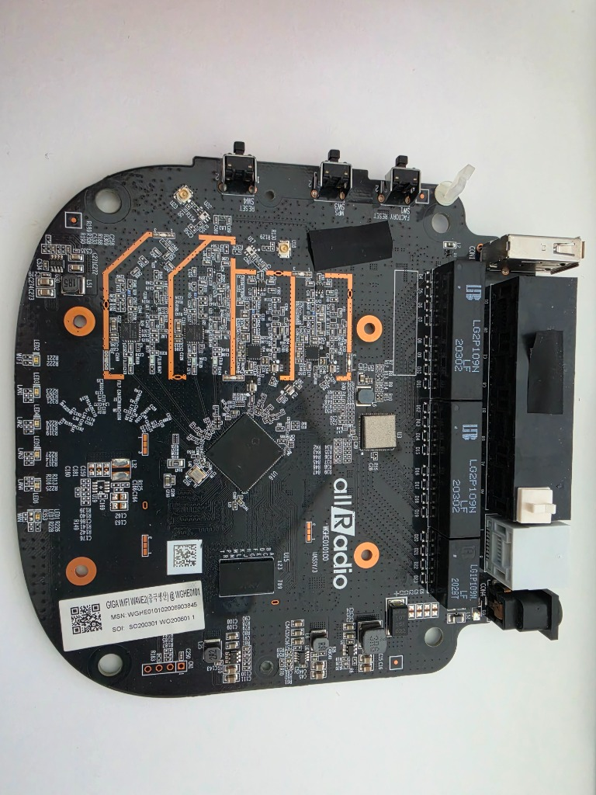
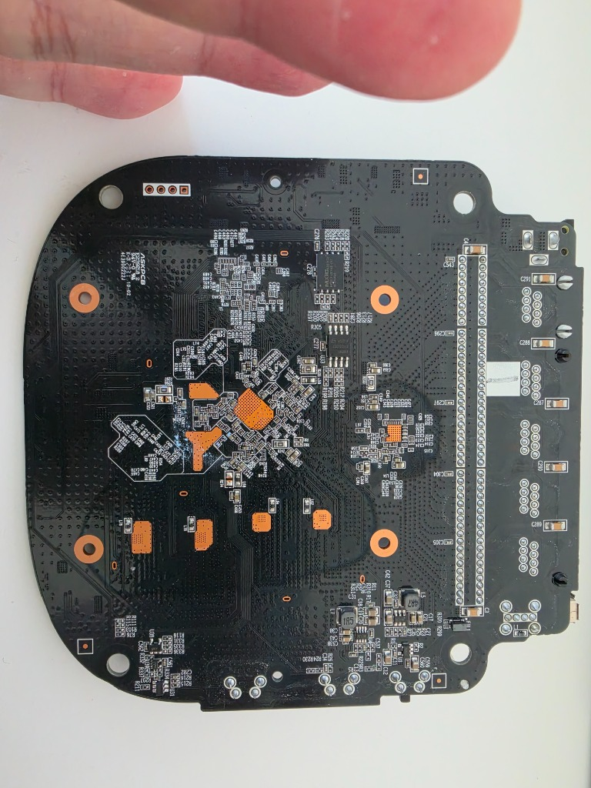
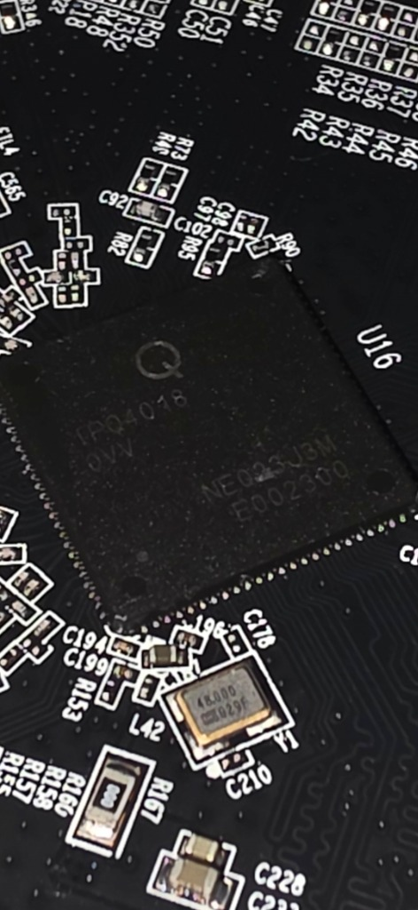
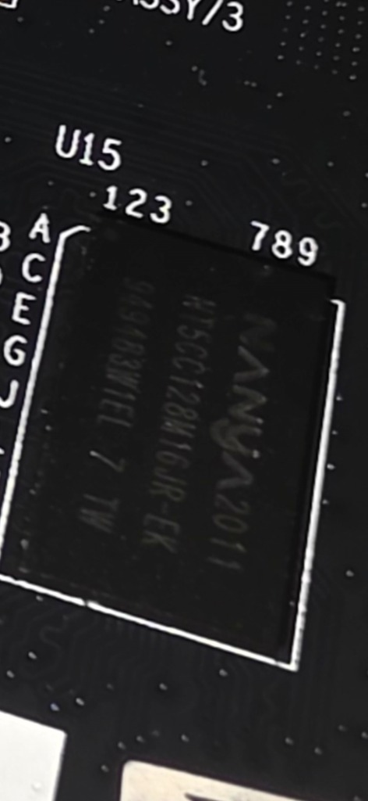
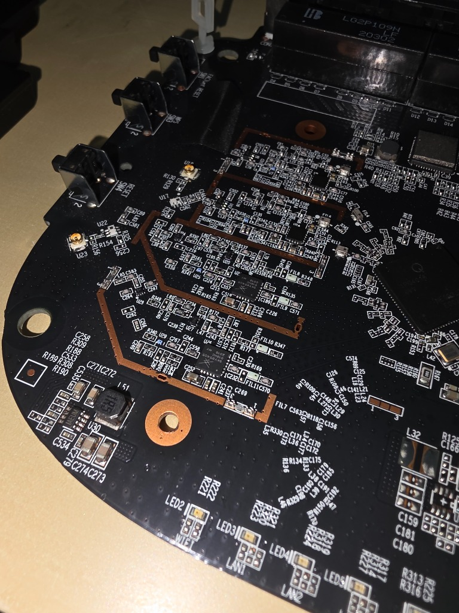
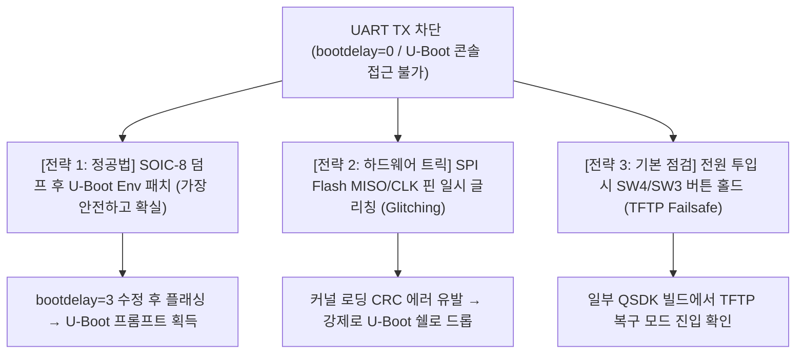
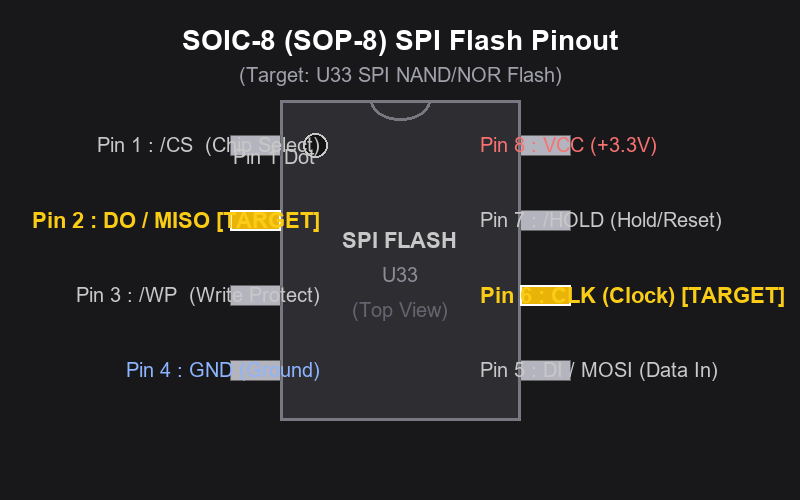

# 현재 작업 상태 — 2026-10-22 업데이트

> **미검증 실험 아이디어(3~6절)는 원문 그대로 보존**했다. 2026-10-22 추가 검토에서 사양표와 연결된 블록도만 사진·로그·제조사 자료에 맞춰 정정했다. 실험 후보를 성공한 TI04 설치 절차로 읽지 않도록 확인 결과와 다음 작업 조건을 구분한다. 이번 업데이트는 새 하드웨어 실험·플래시 쓰기 승인이 아니다.

| 항목 | 현재까지 확인한 결과 |
| --- | --- |
| 대상 | TI04-708H / allRadio, 조사 당시 순정 1.4.0. KM08·R6850 절차와 구분 |
| 플래시 | 실제 UART 로그: **GD25Q16 2MiB SPI NOR + MX35LFxGE4AB 128MiB SPI NAND**. 실물 접미사·패키지·영역 배치는 미확인 |
| UART 수신 | CH343, 115200 8N1로 순정 부팅 로그 확보 |
| UART 입력 | Linux 초기 단계에서 실제 `g`·`^[` 에코 관찰. U-Boot 프롬프트/로그인 셸 진입은 아직 없음 |
| 자동 부팅 중단 | `Press any key to stop autoboot:  0` 표시. Esc 사전/연속 송신 시험에도 커널로 진행 |
| 웹 경로 | 조사한 8899 페이지/스크립트에서 업로드 경로 미발견. 8801 관리자 인증/메뉴는 확보 못함 |
| 설치 후보 | `openwrt-kt9200-*.bin` 두 파일은 sysupgrade TAR이며 부트로더·최초 factory/initramfs 이미지가 아님 |
| CH341A | SOIC8·SOP8 클립·1.8V 어댑터 포함 세트 구매. 실물 전압·연결·읽기 성공은 아직 미검증 |
| 쓰기/설치 | 이번 조사에서 플래시 쓰기·지우기·부트로더 교체·OpenWrt RAM/영구 설치를 수행하지 않음 |

**다음 작업:** 칩/프로그래머 식별 → 전압 확인 → 2MiB NOR 원본 3회 읽기·검증 → 실제 부트로더/환경의 UART 중단 코드 분석. **2MiB NOR만 읽어서는 128MiB NAND를 포함하는 전체 장비 백업이 되지 않는다.**

- [후속 시험 기록·실험 후보와의 차이·다음 작업 체크리스트](docs/HANDOFF.md)
- 사각 CN1 ①은 약 3.3V 측정만으로 VCC가 확정되지 않는다. ②→어댑터 RX, ③→어댑터 TX, ④→GND 배선에서는 Linux 초기 입력 에코를 관찰했다. VCC·5V 전원선은 미연결로 시험했다.
- 아래의 환경 패치·핀 글리칭·버튼 복구·공통 TFTP 명령은 **검증되지 않은 원래 아이디어**다. 환경 패치 성공, 복구 IP, 강제 셸 진입, 안전한 RAM 주소를 확인했다는 뜻은 아니다. 실제 시행 전 별도 검토가 필요하다.
- `CONFIG_AUTOBOOT_KEYED`는 표준 U-Boot의 **중단 문자열 검사** 분기이며 입력 검사 제거와 같은 뜻이 아니다. `bootdelay=0`의 효과도 빌드 옵션과 제조사 수정에 따라 달라진다. [표준 소스](https://github.com/u-boot/u-boot/blob/v2012.07/common/main.c#L83-L247)
- 일부 CH341A 보드는 VCC 3.3V와 달리 신호선이 약 5V일 수 있다. GD25Q16C는 제조사 기준 2.7~3.6V이므로 실제 접미사를 확인하고 **1.8V 어댑터를 무조건 쓰지 않는다.** [flashrom 주의사항](https://github.com/flashrom/flashrom/blob/main/doc/supported_hw/supported_prog/ch341ab.rst), [칩 사양](https://www.gigadevice.com/product/flash/spi-nor-flash/gd25q16c)

### 읽은 파일 검증 도구

Python 3.8+로 로컬 파일만 비교한다. 장비/프로그래머를 조작하지 않는다.

```sh
python scripts/verify_dump.py --expected-size 2097152 dump/nor-read1.bin dump/nor-read2.bin dump/nor-read3.bin
python -m unittest discover -s tests -v
```

최소 2개 비교를 지원하되 실제 작업은 별도 읽기 3회를 권장한다. 빈 파일·전부 00/FF·중복 파일·예상 크기 불일치·해시 불일치·읽기 오류를 실패로 처리한다. **성공 메시지는 반복 일치 검사 통과일 뿐 올바른 원본/복구 가능성의 보증이 아니다.**

원본 덤프·추출물·펌웨어·로그·세션은 기본 Git 제외 대상이다. 개별 키·계정·쿠키를 추가하지 않는다. 아래 기존 사진/본문에는 식별 라벨이 있을 수 있고, `.gitignore`가 과거 Git 이력이나 이미 추적된 자료를 비식별화하지는 않는다.

---

<!-- Experimental proposals in sections 3-6 are preserved; hardware specifications are corrected separately. -->

# KT GiGA WiFi Wave2 (올레디오 TI04-708H / WGHE0101) PCB 정밀 분석 보고서

이 보고서는 제공해주신 PCB 사진들을 바탕으로 공유기의 세부 하드웨어 부품 구성을 분석하고, **SOIC-8 클립을 이용한 펌웨어 덤프 주의사항**, **REA(Reverse Engineer Anything)를 통한 바이너리 분석**, 그리고 **OpenWrt 포팅 및 설치 로드맵**을 상세히 정리한 문서입니다.

---

## 1. 장치 식별 및 개요

| PCB 전면 (Top View) | PCB 후면 (Bottom View) |
| :---: | :---: |
|  |  |


- **제품 모델명**: **올레디오 (allRadio) TI04-708H** (KT GiGA WiFi Wave 2)
- **보드 모델 / 리비전**: `WGHE010100` / `WGHE0101` (`UASSY/3`)
- **제조사**: **(주)올레디오 (allRadio Co., Ltd.)** (보드 상단 대형 `allRadio` 로고 각인)
- **스티커 식별 정보**:
  - `GIGA WiFi WAVE2(중국생산) @WGHE0101`
  - `MSN: WGHE010102006903845`
  - `SOI: SO200301 WO200601 1` (2020년 생산분)
- **통신사 공급 배경**:
  - KT는 '기가 와이파이 웨이브2'를 3대 협력사(머큐리 `KM08-708H`, 올레디오 `TI04-708H`, 다보링크 `DV01-901H`)를 통해 공급받았습니다.
  - 본 보드는 그중 **올레디오의 독자 설계 보드(WGHE010100)**로, 퀄컴 IPQ4018 플랫폼을 기반으로 제작되었습니다.
- **PCB 제조**: ASKPCB (`94V-0`, `E239218`)

```mermaid
graph TD
    subgraph Core System
        SoC["Qualcomm IPQ4018<br/>4-Core ARM Cortex-A7 / up to 717MHz"]
        RAM["Nanya DDR3L SDRAM<br/>256MiB / DDR3L-1866 grade"]
        NOR["GD25Q16 SPI NOR<br/>2MiB / package and location unconfirmed"]
        NAND["MX35LFxGE4AB SPI NAND<br/>128MiB / package and location unconfirmed"]
        XTAL["48.000 marking / Y1<br/>Crystal-reference candidate"]
        SoC --- RAM
        SoC --- NOR
        SoC --- NAND
        SoC --- XTAL
    end

    subgraph RF Front-End (2.4G / 5G Wave2)
        FEM1["5GHz PA: Skyworks SKY85405"]
        FEM2["5GHz PA: Skyworks SKY85405"]
        FEM3["2.4GHz RF path<br/>Components unconfirmed"]
        FEM4["2.4GHz RF path<br/>Components unconfirmed"]
        SoC --- FEM1 & FEM2 & FEM3 & FEM4
    end

    subgraph Network & I/O
        ETH["Ethernet / 1x WAN + 4x LAN<br/>Exact PHY wiring unconfirmed"]
        MAG["LAN Transformers<br/>2x LG2P109N + 1x LG1P109N"]
        USB["USB Type-A Port (CON1)<br/>Speed and firmware functions unconfirmed"]
        UART["UART Console (CN1: 4-Pin Header)"]
        LEDS["LEDs (PWR, WAN, LAN1-4, WIFI)"]
        BTNS["Button labels: SW1 Factory Reset<br/>SW3 WPS / SW4 Reset"]
        SoC --- ETH
        ETH --- MAG
        SoC --- USB
        SoC --- UART
        SoC --- LEDS & BTNS
    end
```

---

## 2. 주요 부품 사양 — 사진·실기 로그·제조사 자료 대조

부품 자체의 정격과 이 보드의 실제 동작은 구분한다. **확인되지 않은 위치·접미사·전압은 추정값으로 채우지 않았다.** 위 블록도도 기능 개요이며 물리 배선/버스 토폴로지의 검증된 회로도가 아니다.

| Qualcomm IPQ4018 SoC | NANYA 256MiB DDR3L RAM | RF 프런트엔드 블록 |
| :---: | :---: | :---: |
|  |  |  |


| 부품 구분 | 실장 위치 (Silk) | 파트 넘버 (P/N) 및 마킹 | 제조사 | 세부 사양 및 역할 설명 |
| :--- | :--- | :--- | :--- | :--- |
| **메인 SoC** | **U16** | 사진의 `IPQ4018` 마킹 | Qualcomm | **4코어 ARM Cortex-A7, 제조사 명시 최대 717MHz** — 716.8MHz 고정 실측값이라는 뜻은 아님.<br/>- 2.4GHz 802.11n / 5GHz 802.11ac 계열 듀얼밴드, 2x2 구성. 802.11ac를 2.4GHz 규격으로 표기하지 않음.<br/>- 제조사 사양은 Ethernet 5포트 지원. 보드의 PHY/스위치 세부 배선은 별도 확인 필요.<br/>- `ipq40xx/generic`은 플랫폼 타깃이며 TI04 보드 공식 지원·최초 설치 이미지 검증과 별개. [Q] |
| **시스템 RAM** | **U15** | `NT5CC128M16JR-EK` | NANYA | **2Gbit = 256MiB DDR3L SDRAM**, 128M x16, **96-ball BGA**. 이 구성/패키지는 기존 표가 맞음.<br/>- **DDR3L-1866 등급(1866Mb/s per pin, 1866MT/s)**은 부품 등급이지 보드의 동작 주파수가 아님.<br/>- 실기 부팅 로그 표기는 `DDR Frequency, 537 MHz`. 실행 중 모든 시점의 주파수·보드 전압을 실측한 것은 아님.<br/>- LuCI/SQM/WireGuard 성능·수용량은 별도 부하 시험 전에는 보장하지 않음. [N][L] |
| **SPI NOR 플래시** | **실장 번호·패키지 미확인** | 로그의 `GD25Q16` — 전체 접미사 확인 필요 | GigaDevice | **2MiB (16Mbit) SPI NOR**. 단일 128MB 플래시로 합쳐 쓰지 않음.<br/>- 칩 표기·JEDEC ID·패키지와 실제 부트로더/환경/보드 데이터 영역은 덤프로 대조해야 함.<br/>- `U33`·SOP8 및 주변 저항의 SPI 기능을 아직 확정하지 않음. [L] |
| **SPI NAND 플래시** | **실장 번호·패키지 미확인** | 로그의 `MX35LFxGE4AB`, 128MiB — 실물 전체 표기 확인 필요 | Macronix | **128MiB (1Gbit) SPI NAND**, 로그의 페이지 크기 2KiB.<br/>- NOR와 별개이며 ECC/OOB·배드블록·백업 형식을 구분해야 함.<br/>- 커널/루트·ART 등의 실제 저장 위치는 순정 영역 분석 전 미확정. [L] |
| **5GHz RF PA** | RF 블록 하단, 실장 번호 재확인 필요 | 사진의 `SKY85405` 마킹. 자료 대조 대상 `SKY85405-11`, 실물 접미사는 미확정 | Skyworks | **5GHz 802.11ac용 PA + 전력 검출기**.<br/>- **PA+LNA+SPDT 통합 FEM이라는 기존 설명은 잘못됨.** 자료의 블록도는 PA·정합·검출기 구성.<br/>- 채널 폭·MU-MIMO는 SoC/무선 시스템 기능이며 이 PA 자체의 기능처럼 적지 않음. [S] |
| **2.4GHz RF 경로 부품** | RF 블록 상단으로 분류했던 영역 | 정확한 부품번호 미확인 | **미확인** | 2.4GHz RF 경로로 분류한 사진 영역. 부품별 PA/LNA/스위치·제조사·연결은 추가 확인 필요.<br/>- `400Mbps / 256-QAM / 2x2`를 미식별 FEM의 고유 사양으로 단정하지 않음. |
| **이더넷 트랜스포머** | T1~T3 영역, 개별 번호 대조 필요 | 사진의 `LG2P109N LF` 2개, `LG1P109N LF` 1개 | **실장품 제조사 추가 확인** | 5개 Ethernet 단자의 절연/결합용 자기 부품으로 관찰.<br/>- 기존의 `UB (Bothhand)` 단정은 보류. 실장품의 로고·데이터시트 대조 필요.<br/>- 이 부품은 패킷 스위치 IC가 아니며 내부 포트/핀 배선은 별도 확인 필요. |
| **클럭 기준 부품** | **Y1** | `48.000 D29F` 마킹 | **미확인** | **48MHz 크리스털 기준 부품으로 추정**.<br/>- 마킹만으로 능동 `Crystal Oscillator` 모듈인지 수동 수정진동자인지 확정하지 않음.<br/>- 정확한 부품번호·전기적 연결·실측 주파수는 추가 확인 필요. |
| **UART 디버그 헤더** | **CN1** | 4핀 Through-Hole, 사각 패드를 ①로 세는 시험 기준 | - | **시험 설정: 3.3V TTL 수준, 115200 8N1**.<br/>- ①: 약 3.3V 관찰, **VCC 추정이나 미확정·미연결 유지**.<br/>- ②: 보드 TX → 어댑터 RX, 부팅 로그 수신 확인.<br/>- ③: 어댑터 TX → 보드 입력, Linux 초기 에코 근거 확보. U-Boot 처리 확인과는 별개.<br/>- ④: 사용자 확인 GND. 어댑터 VCC/5V는 연결하지 않음. [L] |
| **전원 관리** | U10/L25 주변 등, 기능별 위치 재확인 필요 | `2R2`는 인덕터 마킹. 전원 IC의 정확한 P/N은 미확인 | **미확인** | 다중 전원 레일/전원 변환부로 관찰.<br/>- **Silergy/MPS, 동기식 Buck, Core 1.1V 등을 실측 확정값으로 쓰지 않음.**<br/>- 입력 정격은 본체/어댑터 라벨 대조, 각 레일은 회로 확인·측정 필요. RAM 부품의 정격 전압과 보드의 실측값을 구분. |
| **USB 및 버튼** | **CON1, SW1/SW3/SW4** | USB Type-A, 택트 스위치 | - | **CON1**: USB-A 포트. USB 2.0/3.0 규격·외장 스토리지/모뎀 기능은 이번 시험에서 검증하지 않음.<br/>- 사진의 버튼 표기: **SW1 FACTORY RESET / SW3 WPS / SW4 RESET**.<br/>- 표기 확인과 실제 GPIO·복구 부팅 기능 확인은 별개. |

### 사양 근거와 판정 범위

- **[Q]** [Qualcomm IPQ4018 제품 사양](https://www.qualcomm.com/networking-infrastructure/products/ipq4018): 4코어·최대 717MHz·Ethernet 5포트·2x2·2.4/5GHz·MU-MIMO 등 **제품 능력**. 실기 측정 결과를 대신하지 않는다.
- **[N]** [NANYA DDR3L 공식 목록](https://www.nanya.com/en/Product/List/450/7591): `NT5CC128M16JR-EK`의 2Gb·x16·1866Mbps·96-ball BGA. **용량과 패키지는 오류가 아니라 유지 항목**이다.
- **[S]** [Skyworks SKY85405-11 Product Summary](https://www.skyworksinc.com/-/media/B0BE21ADDC38445E93B967915E2A6B3A.pdf): 5GHz PA + 전력 검출기, 20핀 4x4mm QFN. 사진의 완전한 접미사·실장 위치를 추가 대조해야 한다.
- **[L]** 비공개 원본 `uart-20261021-133347.bin`: NOR/NAND/DRAM과 부팅 단계의 DDR 537MHz 표기, 대응 송신 기록의 실제 에코 관찰. 전체 로그 대신 [인수인계 발췌/설명](docs/HANDOFF.md)을 공개한다.

**아래 3~6절은 기존 실험 아이디어를 보존한 구간이다.** 해당 구간의 초기 가정과 현재 사양이 다르면 위의 수정 사양표와 후속 작업 기록을 기준으로 구분하며, 실험을 실제 시행하기 전에 다시 검토한다.

---

## 3. SOIC-8 클립을 이용한 펌웨어 덤프 핵심 가이드

사용자께서 **SOIC-8 롬 집게(클립)**를 물려서 롬 라이터(CH341A 등)로 펌웨어를 덤프할 계획이시므로, 다음 사항을 반드시 확인하셔야 합니다.

> [!WARNING]
> ### 1) SPI NOR vs SPI NAND 차이점 주의
> - 통상적인 24/25 시리즈 SPI NOR(16MB~32MB)는 일반 프로그래머 프로그램(기본 CH341A 소프트웨어)으로 바로 읽힙니다.
> - 하지만 본 장비의 플래시는 **128MB 대용량(1Gb)**이므로 **SPI NAND Flash**(예: Winbond W25N01GV, Macronix MX35LF1GE4AB, GD5F1GQ4 등)일 가능성이 매우 높습니다.
> - SPI NAND는 일반 NOR 명령어(`0x03`/`0x0B`)가 아니라 페이지 단위 캐시 로드(`0x13`) 후 리드하는 구조입니다.
> - **해결책**: 일반 소프트웨어 대신 **NeoProgrammer v2.2.0.10 이상**, **AsProgrammer (SPI NAND 스크립트 포함 버전)**, 또는 **SNANDer CLI** 도구를 사용해야 정상 인식 및 덤프가 됩니다.

> [!IMPORTANT]
> ### 2) ISP(In-System Programming) 클립 체결 시 백파워 현상
> - 보드에 전원을 끈 상태로 SOIC-8 클립을 물리면, 프로그래머의 3.3V 전원이 플래시 8번 핀(VCC)을 통해 **IPQ4018 메인 칩과 보드 전체의 3.3V 레일로 역류(Back-powering)**합니다.
> - 이로 인해 전압 강하가 발생해 3.3V가 2.2V~2.7V로 떨어지거나, SoC가 어설프게 깨어나면서 SPI 버스를 잡고 늘어져 프로그래머가 칩 ID를 읽지 못하는 경우가 흔합니다.
> - **해결 팁**:
>   1. **RESET 핀 접지**: SoC가 버스를 점유하지 못하도록 리셋 신호를 GND로 묶어 High-Z 상태 유지.
>   2. **전원 보강**: 프로그래머의 3.3V 대신 보드에 정격 전원 어댑터를 연결한 뒤 **프로그래머의 VCC 선은 연결하지 않고 GND, CLK, CS, MISO, MOSI만 연결**하여 읽기 (※ 전압 레벨 3.3V 일치 필수).
>   3. 칩 인식이 안 될 경우 가장 깔끔한 방법은 열풍기(350°C)로 U33 칩을 디솔더링 후 SOP8 변환 기판에 올려 덤프하는 것입니다.

> [!TIP]
> ### 3) 덤프 무결성 검증 (필수)
> - SOIC-8 집게는 핀 접촉 불량이 매우 흔합니다.
> - 반드시 **2회 이상 연속으로 덤프**를 받은 뒤, 두 파일의 `SHA-256` 해시값을 비교하십시오. 해시값이 단 1비트라도 다르면 접촉 불량으로 덤프 데이터가 깨진 것이므로 다시 집게를 물려야 합니다.

---

## 4. REA 및 바이너리 분석 방안

덤프받은 바이너리를 분석할 때 중점적으로 확인해야 할 사항입니다.

1. **파티션 테이블 및 구조 분석**:
   - `binwalk -Me firmware_dump.bin` 실행
   - 퀄컴 IPQ4018은 고유의 부트 체인 구조를 가집니다:
     - `SBL1` (Secondary Bootloader) &rarr; `SBL2` / `SBL3`
     - `QSEE / TZ` (TrustZone 보안 환경)
     - `CDT` (DDR 파라미터 테이블)
     - `APPSBL` (Qualcomm 커스텀 U-Boot)
     - `HLOS / Kernel` (Linux Kernel FIT 이미지 또는 uImage)
     - `rootfs` (SquashFS 또는 UBIFS)
     - **`ART` (Atheros Radio Test) / `caldata` (★가장 중요)**

2. **`caldata` (ART 파티션) 백업**:
   - IPQ4018 내장 라디오 및 Skyworks SKY85405 FEM의 **RF 튜닝 값, 송신 출력 캘리브레이션 값, MAC 주소**가 들어있습니다.
   - 이 파티션 데이터가 없으면 OpenWrt를 올려도 무선 출력이 비정상적이거나 5GHz Wi-Fi가 켜지지 않습니다. 반드시 추출하여 보관하십시오.

3. **REA (Reverse Engineer Anything) 활용**:
   - 추출된 U-Boot 바이너리와 커널 DTB(Device Tree Blob)를 분석하여:
     - 보드의 정확한 **GPIO 핀 맵**(LED 제어 핀, 리셋 버튼 핀)
     - **QPIC / SPI 버스 주소** 및 파티션 오프셋
     - 이더넷 스위치 포트 매핑 (WAN 포트 및 LAN 1~4 포트 번호)
   - 통신사 고유 데몬(`kt_daemon`, `cwmp`/TR-069 관리 모듈)의 구조 및 통신 방식 분석

---

## 5. OpenWrt 포팅 및 설치 로드맵

IPQ4018은 이미 OpenWrt 공식 소스 트리의 **`ipq40xx` 타깃**에서 매우 안정적으로 지원되고 있습니다 (유사 기종: ASUS RT-AC58U, GL.iNet GL-B1300, ZyXEL NBG6617 등).

```mermaid
flowchart TD
    A["SOIC-8 클립으로 Full Dump 백업 (2회 해시 일치 검증)"] --> B["Binwalk & REA로 파티션 구조 및 caldata(ART) 추출"]
    B --> C["CN1 포트에 USB-to-UART 연결 (115200 8N1)"]
    C --> D["U-Boot 콘솔 진입 및 TFTP 네트워크 부팅 테스트"]
    D --> E["OpenWrt ipq40xx 맞춤형 DTS (Device Tree) 작성"]
    E --> F["initramfs-kernel 빌드 및 RAM 상에서 사전 검증"]
    F --> G["플래시에 sysupgrade 설치 및 완제품 완성"]
```



1. **UART 콘솔 연결 (보조 안전장치)**:
   - 보드 좌측 하단의 `CN1` (4핀 홀)에 핀헤더를 납땜하고 USB-to-UART 모듈을 연결합니다.
   - 설정: `115200 Baud, 8 Data bits, No Parity, 1 Stop bit`.
   - 부팅 시 콘솔 로그를 통해 U-Boot 진입 키(`Enter` 또는 `Space`)를 눌러 U-Boot 프롬프트에 접근할 수 있습니다.

2. **위험 없는 테스트 (TFTP Initramfs 부팅)**:
   - 롬을 바로 덮어쓰지 말고, OpenWrt `ipq40xx`의 `openwrt-ipq40xx-generic-initramfs-kernel.bin` 이미지를 PC의 TFTP 서버에 올립니다.
   - U-Boot 콘솔에서:
     ```sh
     setenv ipaddr 192.168.1.1
     setenv serverip 192.168.1.100
     tftpboot 0x84000000 openwrt-ipq40xx-generic-initramfs.bin
     bootm 0x84000000
     ```
   - 플래시를 건드리지 않고 RAM에서 OpenWrt가 정상 부팅되는지, 유선 LAN 및 Wi-Fi가 잡히는지 먼저 확인할 수 있습니다.

3. **최종 펌웨어 플래싱**:
   - 하드웨어 제어(DTS)가 검증되면 플래시의 커널/루트 파티션 영역에 OpenWrt를 기록하여 영구 설치합니다.

---

## 6. UART TX 입력 제한(U-Boot 콘솔 락) 원인 및 우회 전략

사용자께서 지적해주신 대로, KT 통신사 순정 펌웨어는 보안 규정상 부팅 시 시리얼 입력을 철저하게 차단해 둡니다.

### 1) 왜 부팅 중 UART TX 입력이 차단되는가?
- **U-Boot 레벨 락**:
  - `bootdelay=0` 설정: 부팅 시 키 입력을 기다리는 대기 시간이 0초로 설정되어 autoboot 인터럽트가 원천 차단됩니다.
  - `CONFIG_AUTOBOOT_KEYED` 또는 입력 폴링 제거: 키 입력이 들어와도 U-Boot 소스에서 `tstc()`/입력 감지 루틴을 호출하지 않고 곧바로 커널 로딩 함수로 진입합니다.
- **커널 부팅 중 무반응**:
  - 부팅 로그는 `console=ttyMSM0` 등을 통해 출력(RX)되지만, 리눅스 시스템이 완전히 초기화되기 전까지는 표준 입력(STDIN) 스트림이 바인딩되지 않습니다.
- **부팅 완료 후 제한**:
  - 완전 부팅이 끝난 뒤에도 일반 bash/ash 쉘이 뜨는 것이 아니라, 통신사용 인증 데몬이 동작하여 알 수 없는 마스터 비밀번호를 요구하거나 serial getty 프로세스를 아예 띄우지 않습니다.

### 2) 우회 전략 3가지



#### 전략 1: SOIC-8 클립 덤프를 통한 U-Boot Env 패치 (추천: 정공법)
사용자께서 계획하신 SOIC-8 덤프가 바로 이 문제를 해결하는 가장 안전하고 확실한 방법입니다.
1. 클립으로 128MB 플래시 덤프(`dump.bin`) 획득
2. 덤프 내에서 **`u-boot-env` (환경변수) 파티션** 탐색 (보통 `0x00040000` 또는 `0x00080000` 오프셋 부근)
3. 텍스트 문자열 중 `bootdelay=0` &rarr; `bootdelay=3`으로 변경
4. U-Boot 환경변수의 앞 4바이트 CRC32 체크섬을 재계산하여 수정
5. 수정된 덤프를 SOIC-8 클립으로 다시 플래시에 기록
6. **결과**: 부팅 시 `Hit any key to stop autoboot: 3` 카운트다운이 활성화되어 스페이스바/엔터로 자유롭게 U-Boot 프롬프트(`ipq40xx# `) 진입 가능!

#### 전략 2: SPI Flash 핀 글리칭 (Fault Injection / Autoboot abort)
덤프 작업을 진행하기 전 즉시 테스트해볼 수 있는 유명한 임베디드 리버스 엔지니어링 기법입니다.



- **2번 핀과 6번 핀 위치 찾는 법 (SOIC-8 표준)**:
  1. **1번 핀(기준점)**: 칩 표면 한쪽 모서리에 파여 있는 **원형 점(Dot / Dimple)** 또는 상단 홈 바로 옆 핀이 **1번 핀(/CS)**입니다.
  2. **반시계 방향 번호 부여**:
     - **1번 핀**: `/CS` (Chip Select)
     - **★ 2번 핀 [DO / MISO]**: **1번 핀 바로 다음 핀 (위에서 2번째 핀)** &larr; 글리칭 대상!
     - **3번 핀**: `/WP` (Write Protect)
     - **4번 핀**: `GND` (접지)
     - (반대편 라인, 아래에서 위로)
     - **5번 핀**: `DI / MOSI`
     - **★ 6번 핀 [CLK]**: **4번 핀(GND) 맞은편 5번 핀 바로 위 (아래에서 2번째 핀)** &larr; 글리칭 대상!
     - **7번 핀**: `/HOLD`
     - **8번 핀**: `VCC` (3.3V 전원, 1번 핀 바로 맞은편)

- **원리**: U-Boot가 플래시에서 커널을 RAM으로 복사하고 CRC 체크섬을 검사할 때, 플래시 신호선을 순간적으로 왜곡시켜 커널 검증 실패를 유도합니다.
- **결과**: 커널 로딩에 실패(`Bad Magic Number` 또는 `Checksum Error`)하면, U-Boot는 자동 부팅을 포기하고 **강제로 인터랙티브 복구 프롬프트(`ipq40xx# `)**로 튕겨 나옵니다.
- **실행 방법**:
  1. 부팅 시 화면에 `Loading Kernel...` 메시지가 뜨는 타이밍 포착
  2. 플래시(U33)의 **2번 핀(DO/MISO)** 또는 **6번 핀(CLK)**을 **100Ω 저항**을 통해 **4번 핀(GND) 또는 보드 접지 링**에 약 0.5초간 살짝 접촉
  3. 콘솔에 에러가 뜨며 U-Boot 프롬프트(`ipq40xx# `)로 떨어지면 즉시 접촉 해제 &rarr; 이후 UART TX 입력이 정상 활성화됨.

#### 전략 3: 리셋/WPS 버튼 홀드 부팅
- 전원 코드를 뽑은 상태에서 보드 상단의 `SW4 (RESET)` 또는 `SW3 (WPS)` 버튼을 누른 채로 전원을 연결하고 5~10초간 유지합니다.
- 퀄컴 QSDK U-Boot 중 일부 빌드는 버튼 입력을 감지하면 autoboot를 우회하고 TFTP 복구 모드(`192.168.1.1` 대기)로 전환되거나 콘솔이 열립니다.

